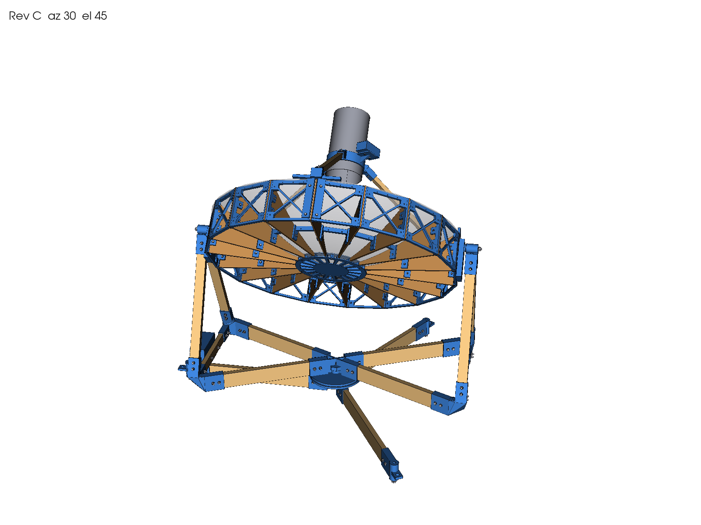

# 1 m hydrogen-line radio telescope

Status: **Rev C, modelled and checked. NOT RELEASED FOR FABRICATION** until the measurements in
`inputs_and_assumptions.md` are taken and the fit coupon `FIT-01` has been printed.

A 1 m prime-focus dish for 1420 MHz built from 18 existing plywood ribs, straight softwood battens and PETG
printed parts (Prusa CORE One L), on an alt-azimuth fork mount. The specification is
`Radio_Telescope_Claude_Code_Master_Prompt.md`; design decisions are in `design_brief.md`.



## Key numbers (from `analysis/assembly_report.md`)

| | |
|---|---|
| Motion | Azimuth unlimited (lazy-susan bearing, M10 kingpin); elevation −5° to 90° (608 bearings, M8 axle) |
| Axle height | 720 mm; the dish centre of mass is 1.1 mm from the axle, so it stays where you leave it |
| Mass | 15.0 kg total: dish 6.7, turning base 5.8, fixed stand 2.5 |
| PETG | about 6.7 kg (24 part types plus the coupon and two jigs), every part fits the 300 × 300 × 330 bed |
| Wood | the 18 ribs plus 8.4 m of batten (19×38, 19×64, 19×19), 16 pieces |
| Hardware | 494 bolts, nuts and washers (M4, M6, M8, M10), four 608 bearings, one 6 in lazy susan |
| Checks | 601 solids, 0 invalid, 0 clashes (parts, every fastener, elevation sweep every 5°, azimuth sweep every 15°) |
| Strength | worst batten 4.0 MPa against 10; worst joint 92 % (ground-leg socket under a 50 N side push) |
| Wind | stable to about 8 m/s with no ballast; 1.5 kg per foot for 10 m/s, 4.4 kg for 12 m/s |

## Open it in Fusion 360 with working joints

1. Start a new empty design with **File > New Design**.
2. Open **Utilities > Add-Ins > Scripts and Add-Ins** (Shift+S). On the Scripts tab, click the green **+** and pick the folder `cad/fusion/telescope_joints`.
3. Select it and click **Run**. It imports `exports/stages/fixed_stand.step`, `turning_base.step` and `dish.step` as three components, grounds the stand, and adds two joints:
   - **Azimuth**: the turning base about the kingpin, with no limit.
   - **Elevation**: the dish about the axle, 0° to 95° of tilt from zenith.
4. Drag the dish to move it, or right-click a joint and choose **Drive Joints**.

For a static view, use **File > Open** on `exports/telescope_revC_az0_el45.step` instead. It has every part as a named body in nested components, with no joints.

## Regenerate

```
pip install -r requirements.txt
python3 cad/build.py --quick       # model and every check, writes analysis/assembly_report.md (about 15 min)
python3 cad/build.py               # the same plus all exports (about 2 h, mostly the STEP assembly)
python3 cad/build.py --az 120 --el 30   # the assembly STEP at another pose
python3 cad/build_ribs.py          # rib audit against the supplied STL
```

All dimensions come from `cad/parameters.yaml`, and each value there is tagged with its status and source. After measuring the ribs, battens and lazy susan, edit that file and rebuild.

## Build order

1. Print `FIT-01`. Set `tolerances` in `cad/parameters.yaml` from what fits, then rebuild.
2. Cut the 60 mm tip relief on each rib and drill three holes using `JIG-01` and `JIG-02`. The DXF template `drawings/RIB_drilling_template_1to1.dxf` is a cross-check (`bom/rib_modifications.csv`).
3. Print the parts in `print/print_list.csv`. Every STL is already laid flat for the bed.
4. Cut and drill the battens from `bom/cut_list.csv`. Hole positions are measured from each end.
5. Assemble the stand, then the turning base, then the dish (hub, ribs, rim bays, spacers, feed). Bolt it to the fork and balance it.

## Files

| Path | Content |
|---|---|
| `cad/parameters.yaml` | Every dimension, tolerance and material value, with status and source |
| `cad/build.py` | Rev C generator: geometry, checks, frame analysis, exports |
| `cad/build_ribs.py` | Rib audit (rib geometry against the supplied STL) |
| `cad/fusion/telescope_joints/` | Fusion 360 script that adds the azimuth and elevation joints |
| `exports/telescope_revC_az0_el45.step` | Full assembly: fixed_stand / turning_base / dish, 601 solids |
| `exports/stages/` | The three stages at home pose (az 0, el 90), used by the Fusion script |
| `exports/parts/` | One STEP per part type, including the coupon and jigs |
| `print/` | Print-oriented STLs and `print_list.csv` (quantity, grams, settings) |
| `bom/bom.csv`, `hardware.csv`, `cut_list.csv`, `rib_modifications.csv` | Parts, fasteners, battens, rib work |
| `drawings/` | Rib drilling template (DXF, 1:1) and PNG views |
| `drawings/rib_audit/`, `exports/rib_audit/` | Rib audit outputs, including the Rev A reference skeleton |
| `analysis/assembly_report.md` | Kinematics, interference, structural and stability results of the last run |
| `analysis/centre_joint.md` | Centre-joint study (Rev A) |
| `design_brief.md` | Design decisions and open items |
| `inputs_and_assumptions.md` | Input register and the measurements still needed |
| `inputs/Wood_Rib_Frame.stl` | Supplied rib outline, the only source of rib geometry |
| `inputs/RadioTelescope.step` | Original Fusion export, kept for the record; it contains no geometry |

## Stage checklist

- [x] 1. Input and geometry audit
- [x] 2. Centre joint (60 mm tip relief, drilled ribs, approved)
- [x] 3. Assembly: dish, feed support, fork mount, azimuth bearing, stand, enclosures
- [x] 4. Structural review (frame analysis, joints, bearings, stability). RF review still open
- [ ] 5. Fabrication package: BOM, print files, cut list and jigs done. Still to do: dimensioned drawings and an assembly guide
- [ ] 6. Commissioning and research package
