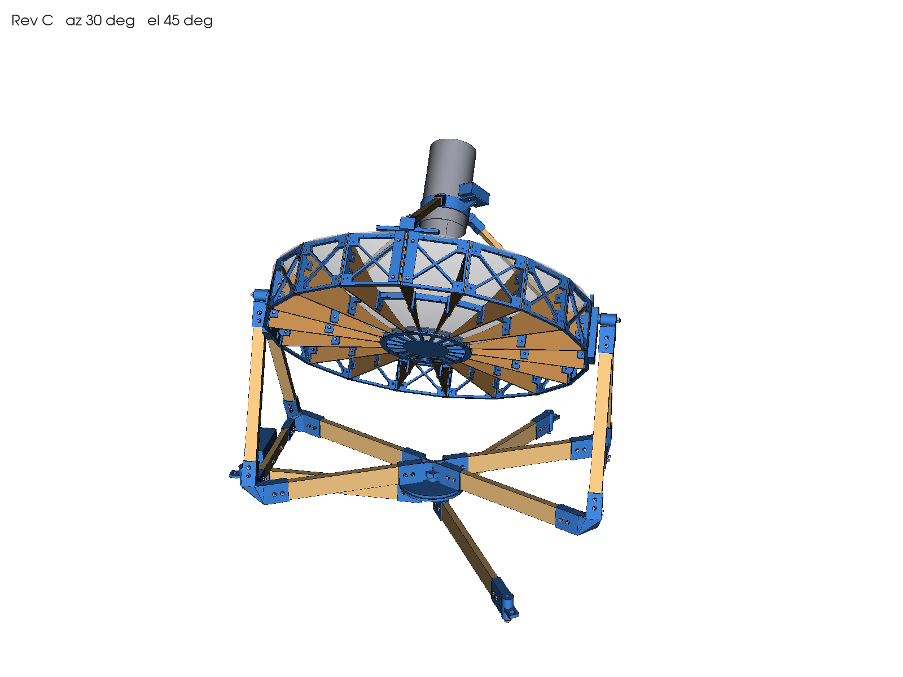
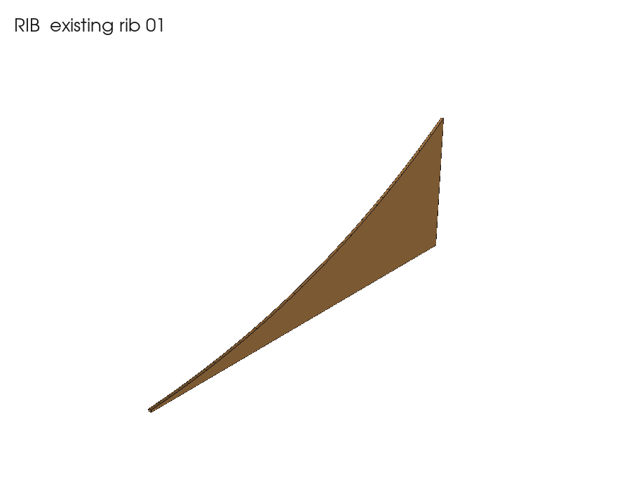
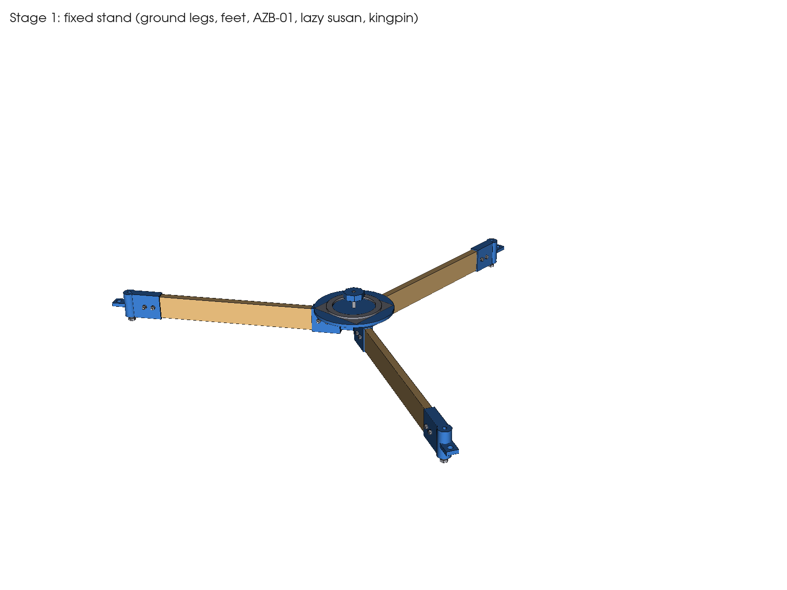
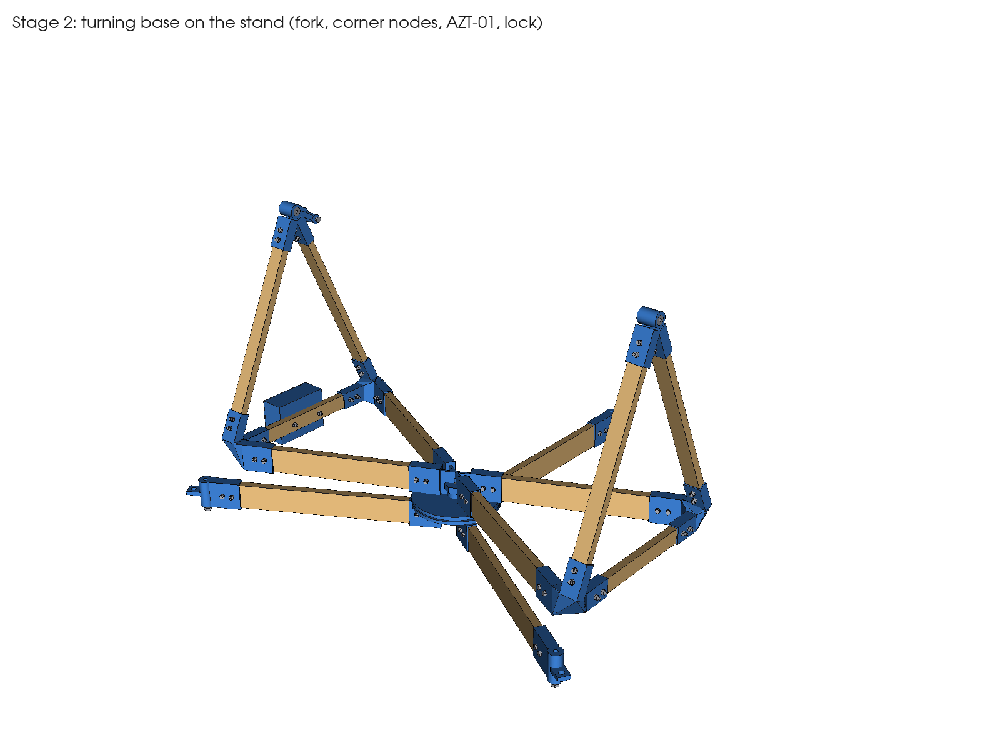
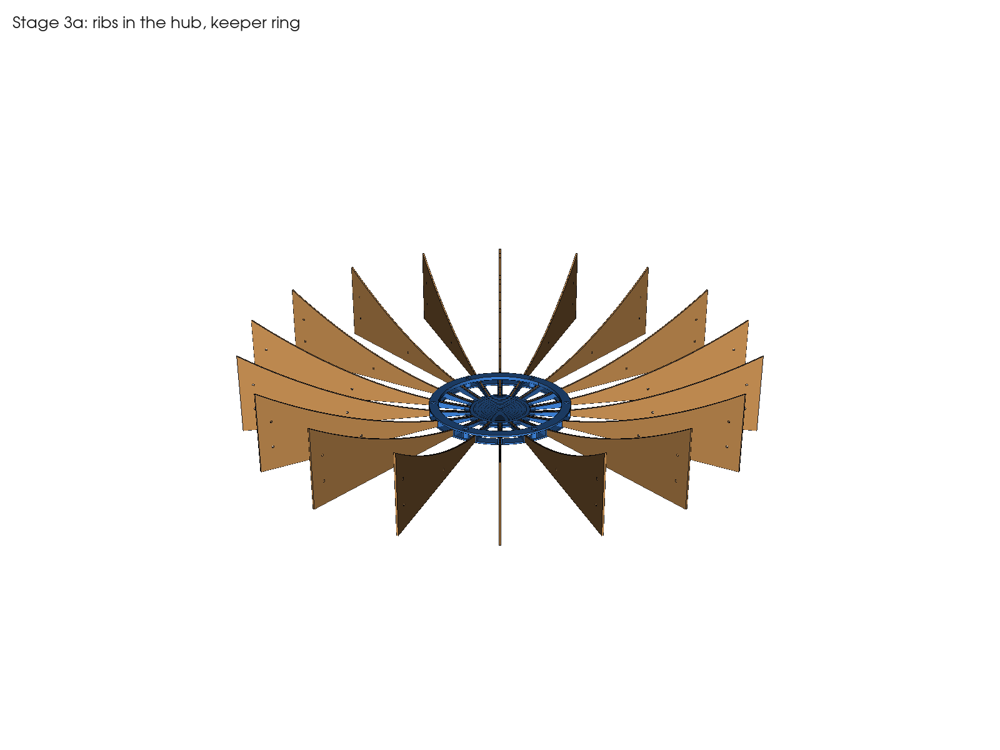
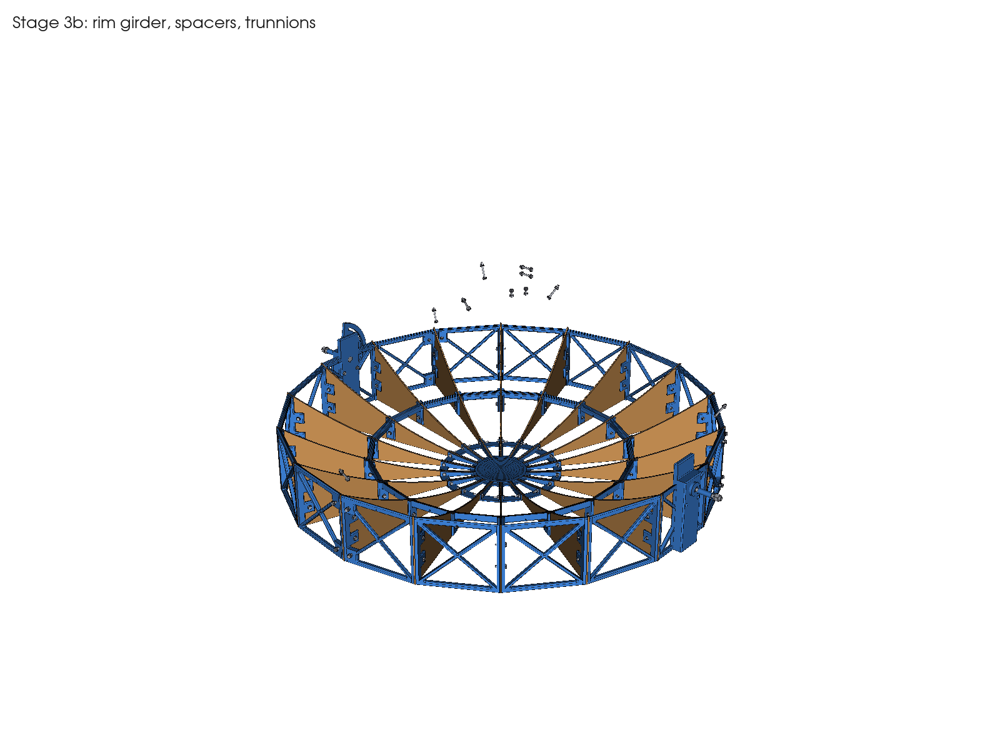
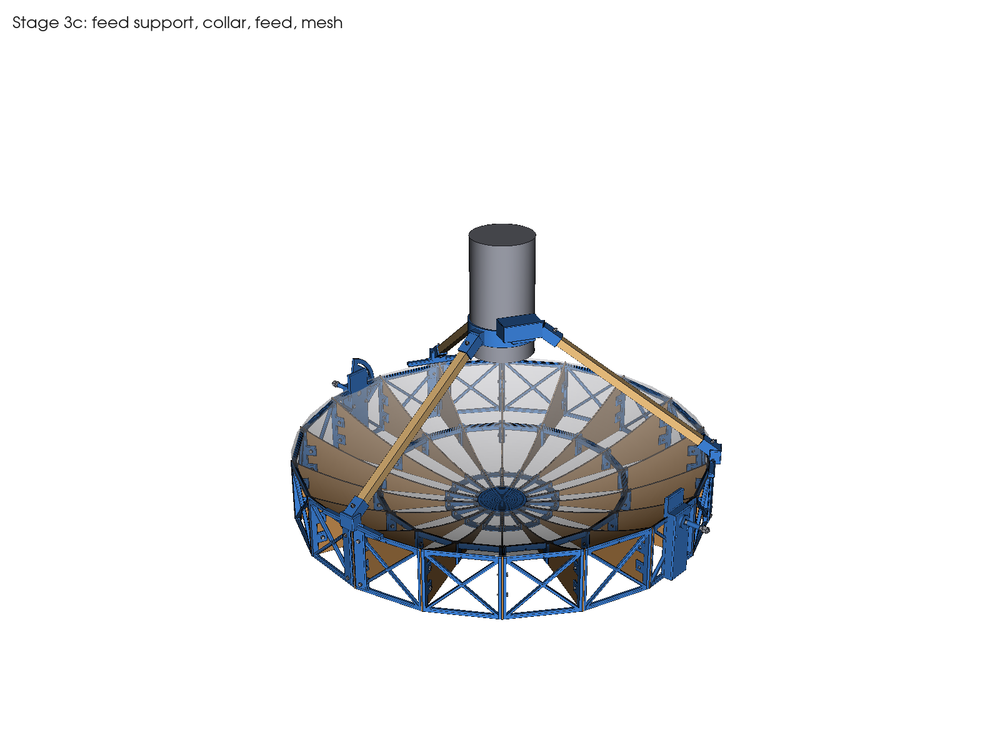
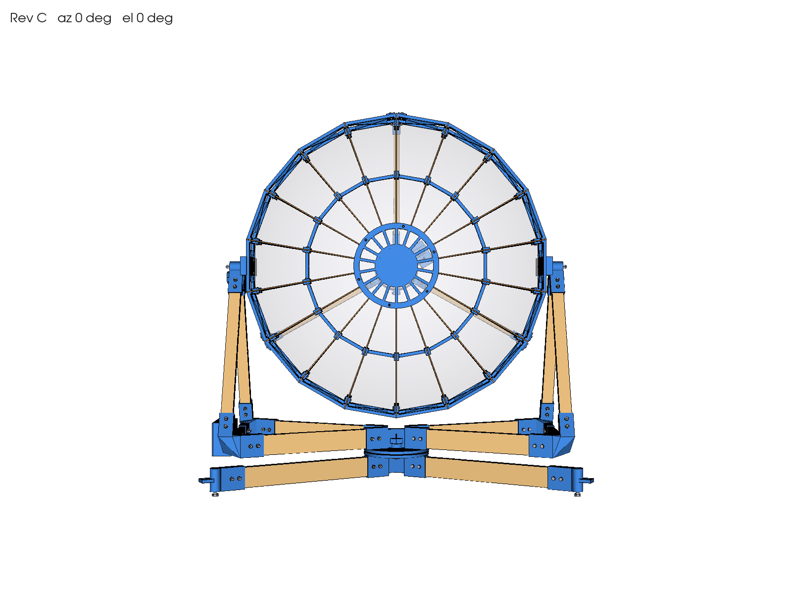
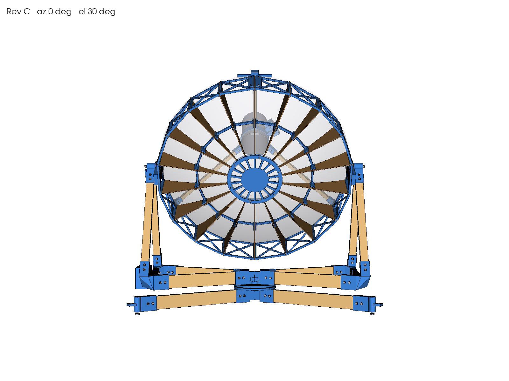

# Assembly guide: Rev C 1 m hydrogen-line radio telescope

Part numbers (for example `RIM-01`) match the files in `print/`, `exports/parts/`, `images/parts/` and the lists
in `bom/`. All bolts are hex-head grade 8.8 with a washer under the head and under the nut unless stated.
"Snug" means tight by hand with a short spanner: PETG creeps if you crush it.

## 0. Before you start

1. **Measure** the rib board, the battens and the lazy susan (see `inputs_and_assumptions.md`). If any differ from
   `cad/parameters.yaml`, change the value and run `python3 cad/build.py` to regenerate every file.
2. **Print `FIT-01` first** with the filament and settings you will use. Check, left to right:
   - 608 bores (22.00 / 22.10 / 22.20 / 22.25): the bearing should press into one bore with a vice and slide into a
     looser one by hand. Set `tolerances.bearing_bore_fixed` and `bearing_bore_float` to those values.
   - Rib slots (rib + 0.2 … + 0.6): pick the narrowest that a rib slides into without forcing. Set `rib_slot_total`.
   - Batten sockets (+0.6 / +0.8 / +1.0): pick the one that takes a 1x2 with light hand pressure. Set `batten_socket`.
   - Nut pockets (+0.2 / +0.4 for M4 and M6): the nut should press in and stay. Set `nut_pocket_af`.
   Rebuild after changing anything.
3. **Print everything** in `print/` (see [printing.md](printing.md)). Press nuts into their hex pockets as you go,
   warming them with a soldering iron if they are tight.
4. **Cut the battens** from `bom/cut_list.csv`: square ends, lengths exact. Drill the cross-bolt holes at the
   distances given, measured from each end, through the thin face and centred on the wide face. Seal the ends.

Tools: drill with 4.5 mm and 6.5 mm bits, saw and mitre box, 7, 10, 13 and 17 mm spanners, calipers, square,
spirit level, soldering iron (for nuts), zip ties.

## 1. Rib preparation (all 18 ribs)

1. Cut the **60 mm tip relief** at the pointed end: a square cut 60 mm from the tip (template:
   `drawings/RIB_drilling_template_1to1.dxf`, print at 100 % and check the 500 mm length).
2. Slide **`JIG-01`** over the rim end of the rib: the end cap against the rib end, the lip under the flat back edge.
   Drill the two 4.5 mm rim holes through the guide.
3. Slide **`JIG-02`** on from the rim end the same way and drill the 4.5 mm mid-span hole (r = 300 mm).
4. Check one drilled rib against the DXF before drilling the rest.

The ribs are only 1/8 in (3.2 mm), so keep the drill square and use light pressure to avoid splintering the back face
(a scrap block behind the rib helps).

## 2. Stage 1: fixed stand

1. Drop the **M10 × 60 kingpin** head-first into the hex pocket on the underside of **`AZB-01`** so the thread
   points up.
2. Push the three **`LEG-G`** ground legs (19 × 64) into the `AZB-01` sockets and fix each with two
   **M6 × 40** cross bolts, washers and nuts. Snug.
3. Press an **M10 nut** into the pocket of each **`FOOT-01`**, push the feet onto the other ends of the legs and
   bolt them (2 × M6 × 40 each). Screw an **M10 × 70 levelling bolt** up through each foot, head down.
4. Stand it up and level `AZB-01` with the three levelling bolts.
5. Lay the **lazy susan** in the square recess on top of `AZB-01` (kingpin through its centre hole).

## 3. Stage 2: turning base and fork

1. Press two **608 bearings** into each fork top node: **`FKT-01`** (+Y side, tight fit, has the lock lug) and
   **`FKT-02`** (−Y side, sliding fit so the axle can float). Press with a vice on the outer race only.
2. Build the lower frame on the floor: four **`SPK-01`** spokes (19 × 64) from **`AZT-01`** to the four corner
   nodes **`FKC-01`** / **`FKC-02`** (FKC-01 at x+y+ and x−y−, FKC-02 at x+y− and x−y+), and the two
   **`SIL-01`** sills (19 × 38) between the corner nodes along X. Two M6 × 40 per socket.
3. Fit the four **`LEG-A`** fork legs (19 × 38) from the corner nodes up to `FKT-01` and `FKT-02`.
   Two M6 × 40 per socket. Check both bearing bores line up by sighting through them.
4. Bolt **`EBOX-01`** to the +Y sill with two **M6 × 35**.
5. Lower `AZT-01` onto the lazy susan so the kingpin comes up through its centre and the upper plate of the
   bearing sits in the recess under `AZT-01`. Add an **M10 washer** and the **M10 nyloc nut**, then press the
   nut into **`KNB-02`**. The knob sets the azimuth drag: turn it until the base turns smoothly but stays where
   you leave it.

## 4. Stage 3: dish

Work on a large flat table with the dish face up (vertex down).

### 4a. Ribs and hub

1. Put **`HUB-01`** on the table, channels up. Press six M4 nuts into its pockets. The hub floor sits 3 mm
   below the flat back edges of the ribs, so put the rib ends on 3 mm scrap (card or hardboard).
2. Stand the 18 ribs in the 18 channels, flat edge down, pointed end toward the centre.
3. Lay **`HUB-02`** (keeper ring) over the rib tips and bolt it with six **M4 × 20** into the hub nuts. Snug.

### 4b. Rim girder, spacers and trunnions

1. Fit the 18 rim bays between the rib ends: sixteen **`RIM-01`** and two **`RIM-T`** trunnion bays. The two
   `RIM-T` must be opposite each other, centred between ribs, on the axle line (Y). Each rib end sits between
   the flanges of two neighbouring bays.
2. At every rib, push two **M4 × 20** through the flange, the rib and the next flange, head on the plain flange,
   nut in the pocketed flange (36 bolts). Tighten in a criss-cross pattern while checking that the rib tops sit
   flush with the bay tops.
3. Fit the 18 **`SPC-01`** spacers between the ribs at mid span; one **M4 × 20** through each rib's mid hole.
4. Bolt the lock sector **`ELS-01`** to the +Y trunnion with two **M4 × 35** (nuts in the sector pockets) and put
   spacer **`SPR-03`** on the −Y trunnion.
5. Drop an **M8 × 90** bolt into the hex pocket inside each trunnion, thread pointing outward.

### 4c. Feed support, feed and mesh

1. Bolt the three feed-leg anchors **`FLA-01`** to the rim at ribs 60°, 180° and 300° (four M4 × 20 each,
   into the neighbouring rim bays).
2. Push the three **`LEG-F`** feed legs (19 × 19) into the anchors and into **`FRG-01`** (feed collar), one
   **M4 × 35** at each end.
3. Slide the **feed can** into the collar, open end toward the dish. Its open end goes at the focus,
   **400.6 mm above the dish vertex**. Clamp it with the two **M4 × 30** pinch bolts. It can slide later for
   focusing.
4. Bolt **`LNA-01`** to the collar shelf (two M4 × 12), fit the LNA and close with **`LNA-02`**.
5. **Mesh**: cut 18 gores (one per bay) from the mesh with about 15 mm overlap. Lay each gore on the rib top edges,
   tuck the centre under `HUB-02` and fasten along the ribs. The mesh fastening is not modelled; the recommended
   method is small zip ties or stainless wire through 2.5 mm holes drilled 5 mm below each rib top edge every
   100 mm. Keep the mesh taut and on the rib edges; ripples up to about 5 mm are acceptable at 21 cm.

## 5. Stage 4: dish into the fork (two people)

1. Push the **M6 × 70 carriage bolt** through the slot of `ELS-01` from the dish side, so its head sits behind the
   sector and its square neck engages the slot.
2. With the dish face sideways (elevation 0), lower it between the fork top nodes. The carriage bolt goes through
   the hole in the `FKT-01` lock lug.
3. Push each M8 axle bolt outward through: trunnion, `ELS-01` (+Y) or `SPR-03` (−Y), **`SPR-01`**, the first
   bearing, **`SPR-02`**, the second bearing, an **M8 washer** and the **M8 nyloc nut**. Tighten until the inner
   races are clamped and the dish still swings freely.
4. On the lock: M6 washer, then **`KNB-01`** (with its captured M6 nut). Hand-tight locks the elevation; the ends of
   the slot are the hard stops at −5° and 90°.

## 6. Check and commission

1. Release the lock. The dish should stay at any angle with the lock open (the centre of mass is about 1 mm from the
   axle). If it drifts, slide the feed can a few mm or tape a small weight to the light side of the rim.
2. Swing the dish through its full range and the base through 360°. Nothing should touch; the closest approach
   is about 25 mm at 15° elevation.
3. Outdoors, hang ballast from the eyes on the feet: none is needed up to about 8 m/s wind, 1.5 kg per foot
   for 10 m/s, 4.4 kg for 12 m/s. Do not leave it out unattended in stronger wind.
4. Route the coax from the LNA down one feed leg, along the rim and down a fork leg to `EBOX-01`, with a loop at the
   axle so the dish can swing. Keep azimuth within ±270° so the cable does not wind up.

## Exploded part list

All part images are in [`images/parts/`](../images/parts/). Quantities, masses and suppliers are in
[`bom/`](../bom/) and [shopping_list.md](shopping_list.md).
