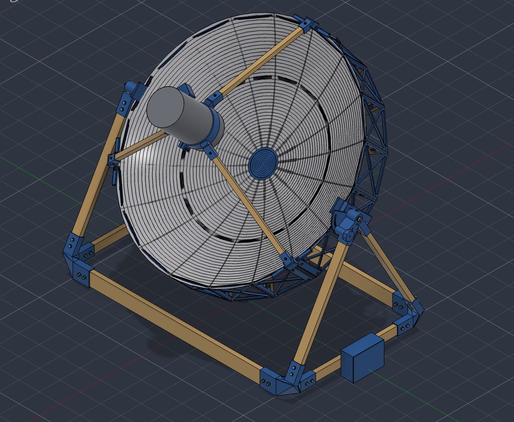
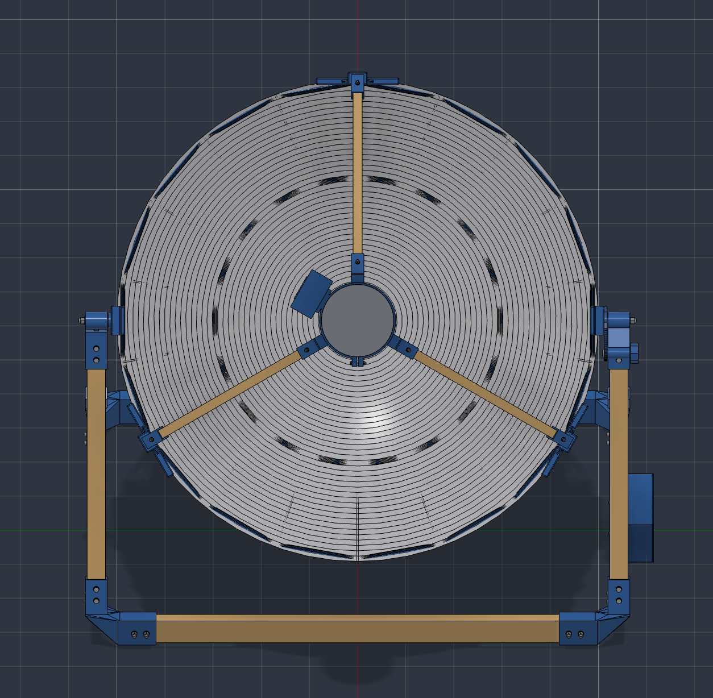
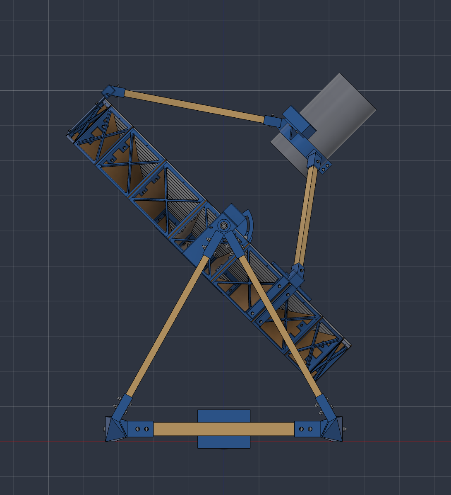
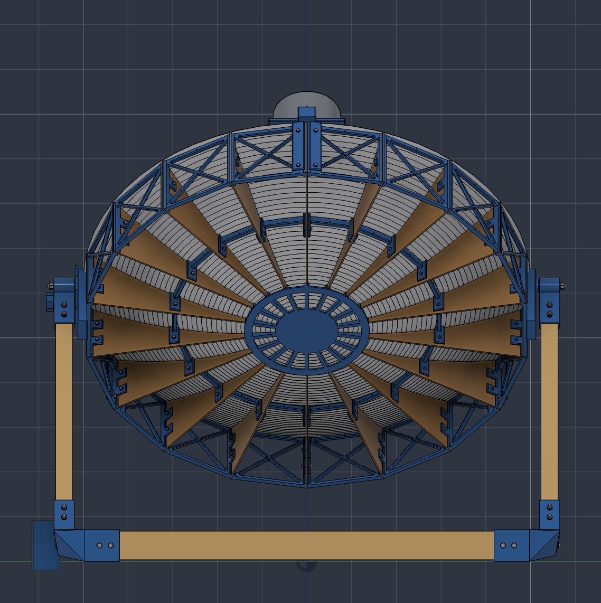
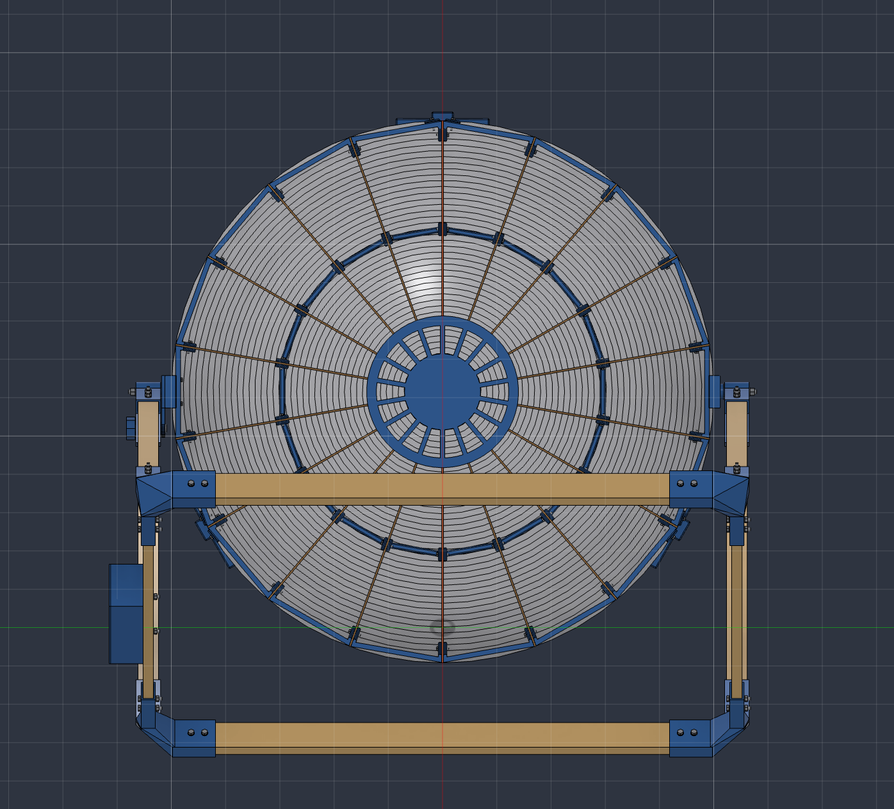
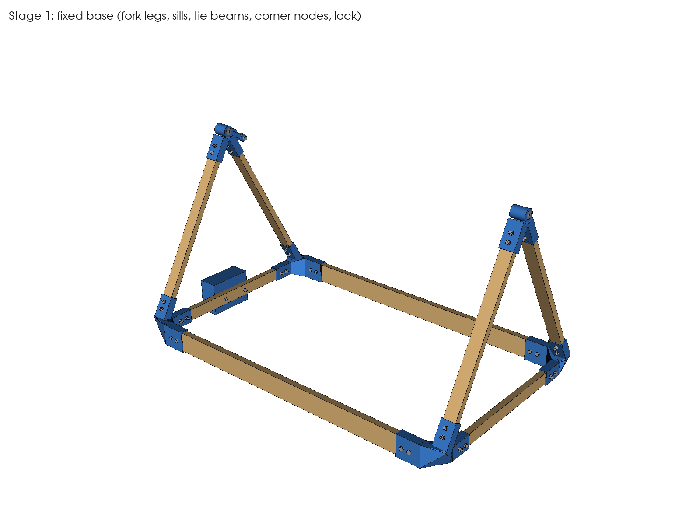
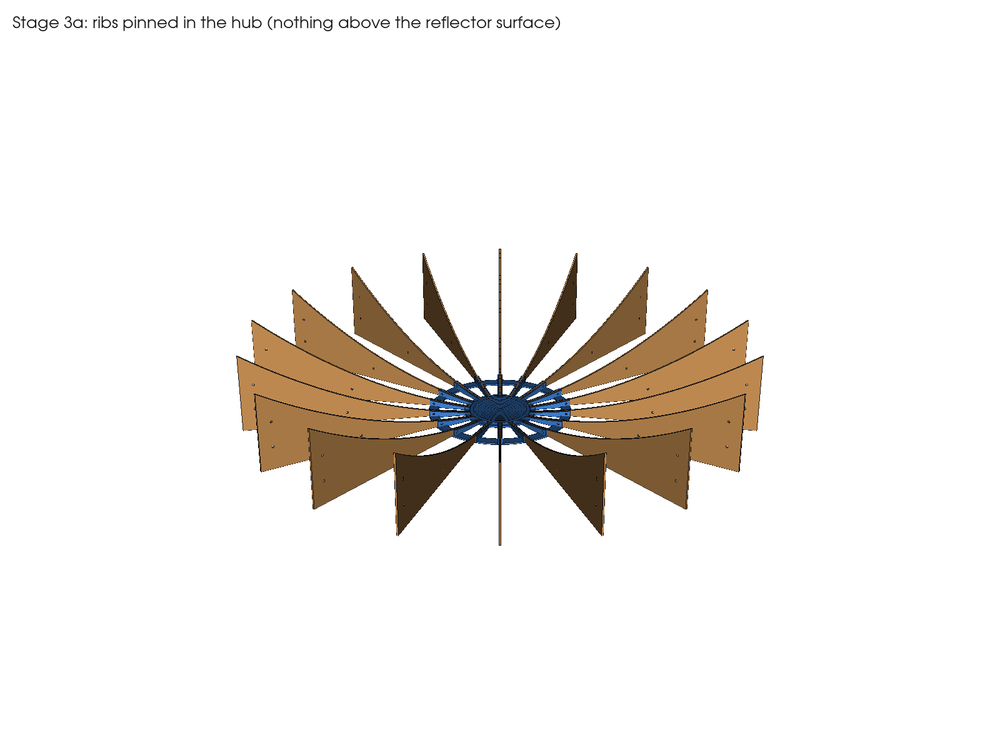
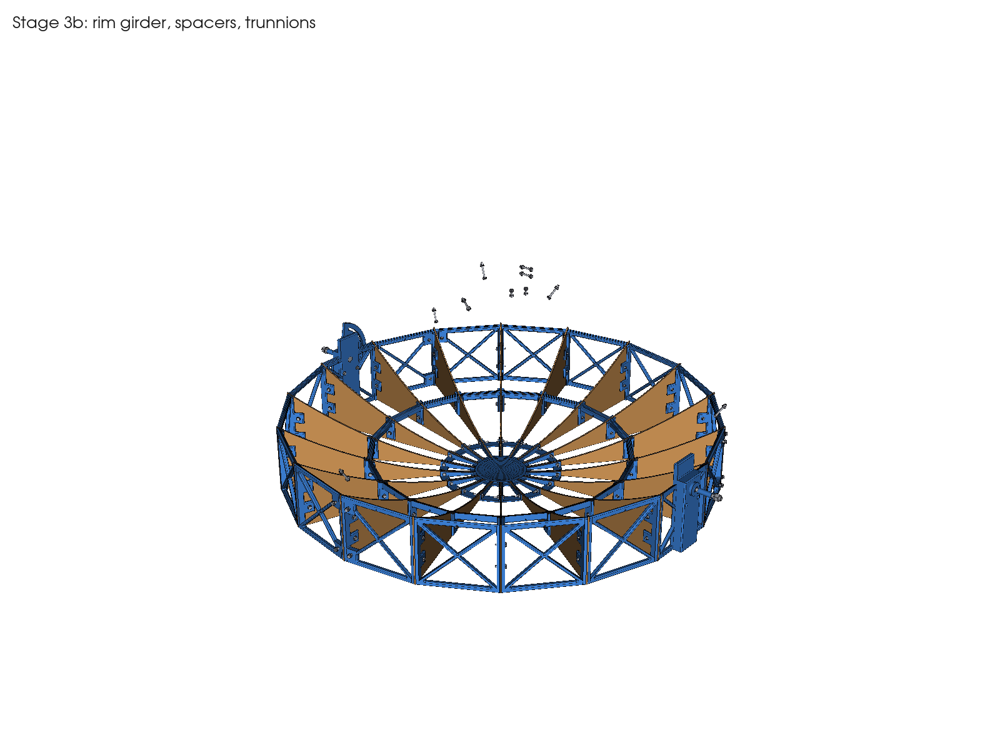
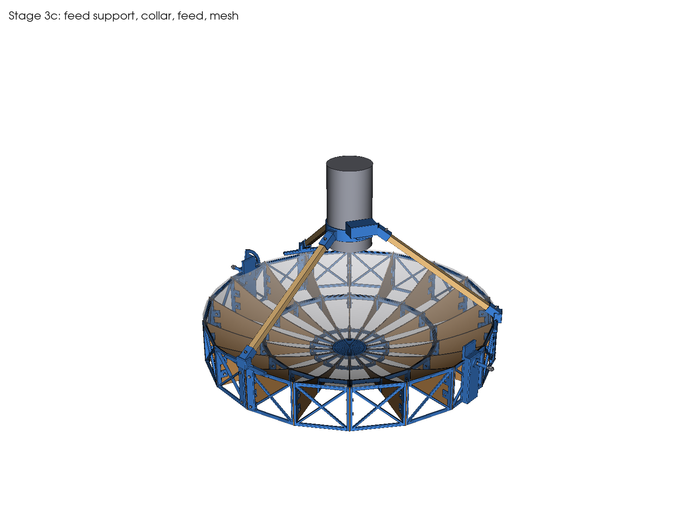

# Rev C.2 CAD gallery

These five views are the user-supplied screenshots of the updated CAD, not photographs of a completed build. The ZIP also includes generated assembly-stage and part renders used throughout the assembly guide.

## Perspective

## Front

## Side

## Rear

## Underside

## Assembly stages

